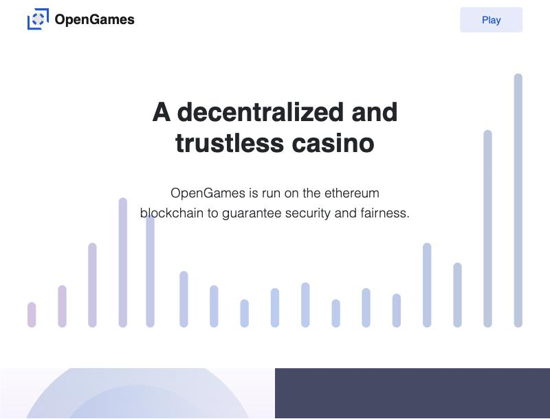
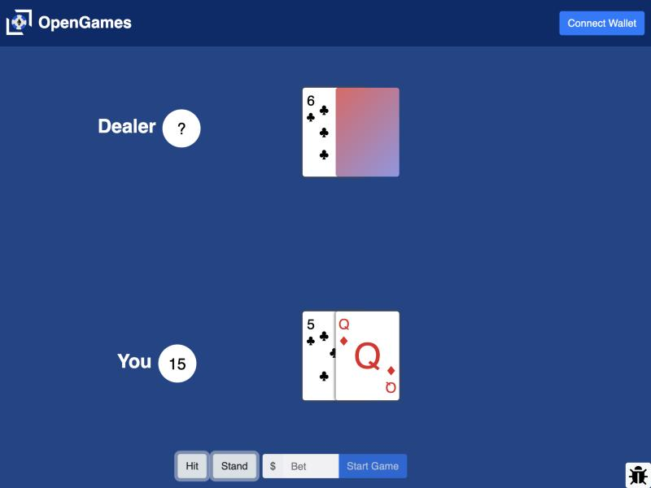
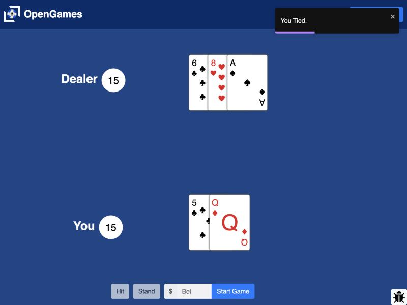

# OpenGames (GameRoomV2)

Blackjack on Ethereum. Your bankroll sits in a smart contract and the game runs in the browser. Built in 2021 and run on the Ropsten testnet.

**Live demo:** https://opengames-15140.web.app. Free play works without a wallet: click Play, then START. The wallet features ran on the Ropsten testnet, which has since been retired, so only free play works today.



| Dealing a hand | After standing |
|---|---|
|  |  |

## What it does

- Connect a browser wallet such as MetaMask, create a user in the contract, and deposit or withdraw ETH.
- Play blackjack against the dealer with Hit and Stand. Bets are entered in USD and converted at the current ETH price from CoinGecko.
- Wins and losses add to a running "tab" that settles when you withdraw.
- A $0 bet is free play and needs no wallet.

## How it works

1. **Contract.** `contract.sol` (Solidity ^0.7.4) keeps a balance per address. It has `createUser`, `depositBalance`, `withdrawBalance(_amount, _tab)` and view functions for balances.
2. **Game.** The blackjack engine runs in the browser (`src/components/blackjack/`). Cards are drawn with `window.crypto.getRandomValues`.
3. **Tab.** The net result of your hands lives in Firestore under `users/<address>` and is passed to the contract when you withdraw.
4. **Frontend.** React 17, react-bootstrap, web3.js and react-router, hosted on Firebase Hosting.

## What I'd change

- Settle hands and the tab on-chain, with the contract checking balances. Draw cards with commit-reveal or a verifiable randomness oracle such as Chainlink VRF, so outcomes can't be inspected or chosen client-side.
- Map random bytes to cards with rejection sampling. The current byte-to-card mapping is slightly biased because 256 isn't divisible by 13.

## Running it locally

```bash
npm install
npm start
```

This opens http://localhost:3000. `src/.firebase.js` points at the original Firebase project, so swap in your own config.

For wallet features, deploy `contract.sol` (with an `Owner` contract) to a network, set `gameRoomContractAddress` in `src/components/connect-smart-contracts.js`, and update the Ropsten chain check (`0x3`) in `src/screens/blackjack.js`.

## Repository layout

```
contract.sol                                GameRoom contract
src/screens/                                landing page, blackjack screen, router
src/components/blackjack/                   game engine and card logic
src/components/connect-smart-contracts.js   web3 calls and contract ABI
docs/                                       screenshots
```
